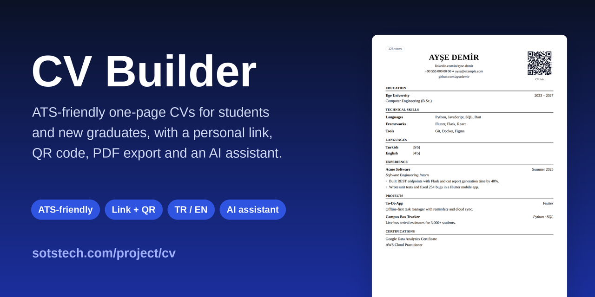
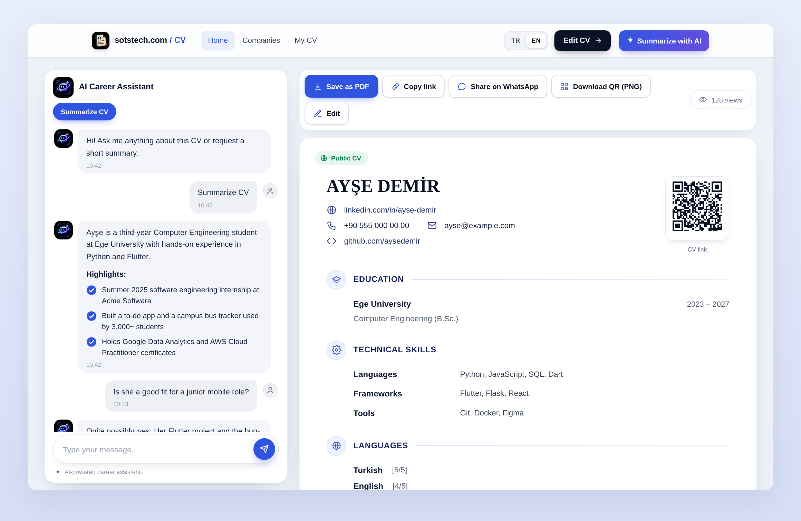
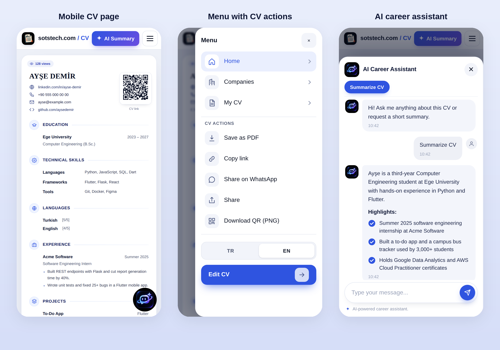
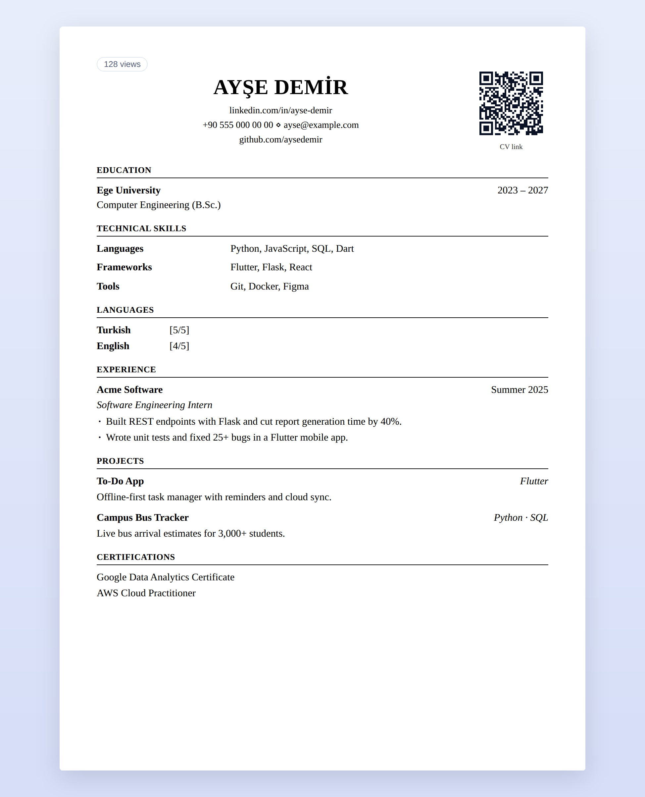

# CV Builder

**ATS-friendly, one-page CVs for students and new graduates — published on a personal link, shared with a QR code, saved as a clean PDF, and explained by an AI career assistant.**

[**Try it live**](https://sotstech.com/project/cv/index.php?lang=en) · [Features](#-features) · [Screenshots](#-screenshots) · [How it works](#-how-it-works) · [Why ATS-friendly](#-why-ats-friendly) · [For companies](#-for-companies)

---

> **About this repository.** This repo is the *showcase* for CV Builder: what it does, how it looks and how it works.
> The application runs live at **[sotstech.com/project/cv](https://sotstech.com/project/cv/index.php?lang=en)** and its source code is not published here.

## 📖 What is it?

Most students build their first CV in a word processor, fight with the layout, and then discover that the fancy template they picked is unreadable for the applicant tracking systems (ATS) recruiters use.

**CV Builder** removes that whole problem. You fill in a short form, watch a live preview, and the moment you save you get:

- a **single-page, single-column CV** with standard section headings,
- your **own public link** (for example in a LinkedIn profile or an email signature),
- a **QR code** that points to that link,
- a one-click **A4 PDF**,
- a **view counter** so you know when your CV is being opened,
- an **AI career assistant** that visitors can ask questions about the CV.

No design work. No account with a real e-mail address or phone number. Just content.

## ✨ Features

### For candidates

| | |
|---|---|
| 🧾 **One-page, ATS-friendly template** | A fixed, clean layout: Education, Technical Skills, Languages, Experience, Projects, Certifications. You only write the content. |
| 👀 **Live preview** | See the finished CV update while you type. |
| 🔗 **Personal link** | Every CV gets its own address that is easy to paste into a message, an e-mail or LinkedIn. |
| 🔳 **QR code** | Generated automatically and downloadable as a PNG, ready for a printed CV or business card. |
| 📄 **PDF export** | Save the CV as a text-based A4 PDF from the browser. |
| 📊 **View statistics** | See how many times your CV was opened today, this week and in total (visible only to you). |
| 🌍 **English / Türkçe** | The whole interface and the CV can be switched between English and Turkish. |
| ✨ **AI CV helper** | Describe yourself in plain words and let the AI draft or improve the CV sections, then edit as you like. |
| 🔄 **AI translation** | Translate a saved CV between Turkish and English in one click. |
| 🔒 **Privacy control** | Hide your CV from search engines so that only people with the link can open it. |

### For people who open a CV

| | |
|---|---|
| 🧠 **AI summary** | One tap gives a short, readable summary of the CV. |
| 💬 **AI career assistant** | Ask questions like *"Is this person a good fit for a junior mobile role?"*. Answers are written out gradually, like a person typing, and stay on the topic of the CV. |
| 📱 **Great on phones** | The CV scales like a paper page on mobile, and the menu holds every action: save as PDF, copy link, share on WhatsApp, native share, download QR. |
| 🚩 **Report button** | Visitors can report CVs that are spam, fake or inappropriate. |

### 🏢 For companies

Companies cannot sign up on their own: they send a request form and are approved manually. Once approved they get a **company panel**:

- candidates appear only after they **choose to apply** to that company,
- **match-score filtering** by department, skills, languages (with a minimum level), projects, certificates, experience and free text,
- smart search that understands **synonyms** (for example "software" also finds "yazılım"),
- **star** the candidates you like and show only the starred ones,
- **export** the list to Excel (`.xlsx`) or CSV,
- candidates can **withdraw** their application at any time.

A candidate's CV data is visible only to the officials of the companies they applied to.

## 🖼 Screenshots

### CV page with the AI career assistant

### On mobile

### The A4 PDF

> Screenshots use demo data (a fictional person). The live product is at the link above.

## 🚀 How it works

1. **Fill in a short form** — name, school, department, country and your own password.
2. **Get your address** — you receive a unique `@sotstech.com` address. To sign in you use that address, your password and a short code shown on screen (no real e-mail or phone needed).
3. **Fill in your CV** — write your content with a live preview. The moment you save, the CV is online with its own link and QR code.
4. **Share it** — copy the link, share on WhatsApp, download the QR, or save the PDF.
5. *(Optional)* **Apply to companies** from the *Companies* page. Your CV then shows up in their panel.

## 🎯 Why ATS-friendly?

Applicant tracking systems parse a CV into structured fields. They tend to struggle with multi-column layouts, text inside images, tables, icons used as labels and creative section names. CV Builder's printed/PDF layout is built to avoid exactly those traps:

- **Single column**, top-to-bottom reading order
- **Standard headings**: Education, Technical Skills, Languages, Experience, Projects, Certifications
- **Real, selectable text** in the PDF (not a screenshot of a page)
- **Plain typography** with no text hidden in graphics
- **Consistent date and role formatting** from a fixed form, so every CV is structured the same way
- **One page**, so the important information is not buried

> No tool can promise how every ATS will behave, but a simple, structured, text-first CV is the best starting point.

## 🔐 Privacy & safety

- No real e-mail address or phone number is required to sign up.
- Passwords are stored hashed, never in plain text.
- You decide who finds your CV: public, or hidden from search engines and reachable only by link.
- Company access is limited to the companies you apply to, and you can withdraw at any time.
- Requests are rate-limited, forms are CSRF-protected, and AI answers are limited to the CV's topic.
- Smart cost control for AI: summaries are cached per CV version, so the same CV is not summarized twice.

## 🧰 Tech overview

| Layer | Technology |
|---|---|
| Backend | PHP |
| Database | MySQL (via PDO) |
| Frontend | Vanilla JavaScript and CSS, responsive and mobile-first |
| AI | OpenAI API for summaries, the career assistant, CV drafting and translation |
| Sharing | Generated QR codes, link-preview images, WhatsApp and native share |
| Exports | Browser A4 PDF, QR as PNG, candidate lists as `.xlsx` / CSV |

## 🔗 Links

- 🌐 **Live app:** <https://sotstech.com/project/cv/index.php?lang=en>
- 🇹🇷 **Türkçe arayüz:** <https://sotstech.com/project/cv/index.php?lang=tr>
- 🏢 **Company request form:** <https://sotstech.com/project/cv/index.php?a=company_request>
- 🏠 **Main site:** <https://sotstech.com>

## 💬 Feedback

Found a bug or have an idea? Open an [issue](../../issues) or use the live site. Contributions to the *documentation* are welcome; the application source is private.

## 📜 License

The text and images in this repository are © SotsTech. All rights reserved. The application is not open source.

